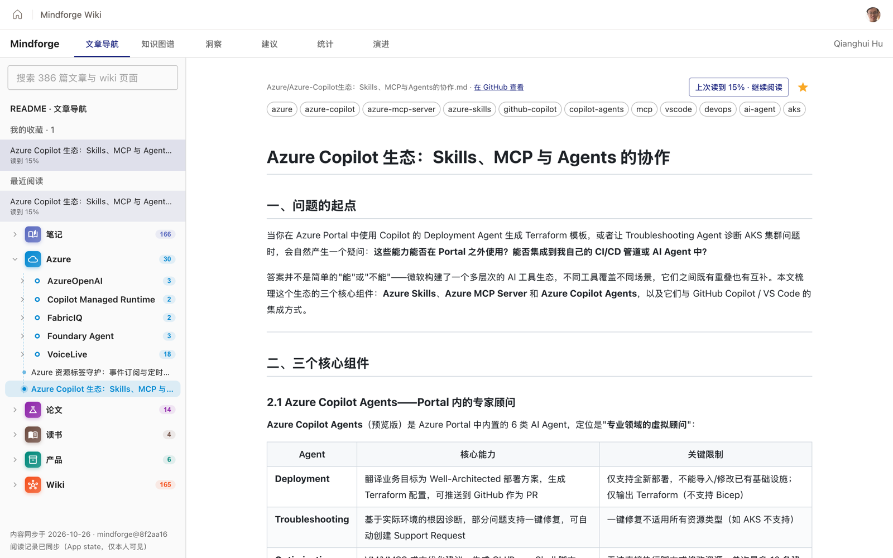
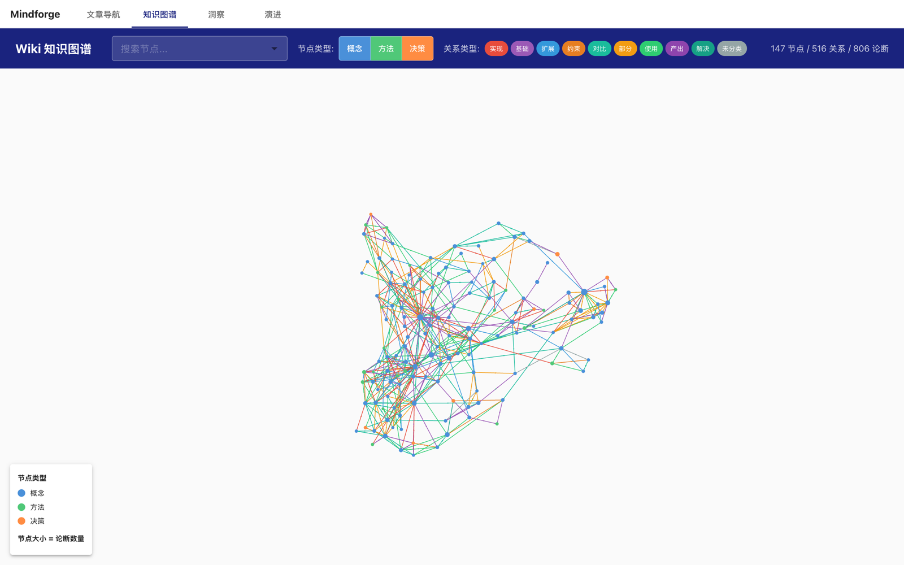
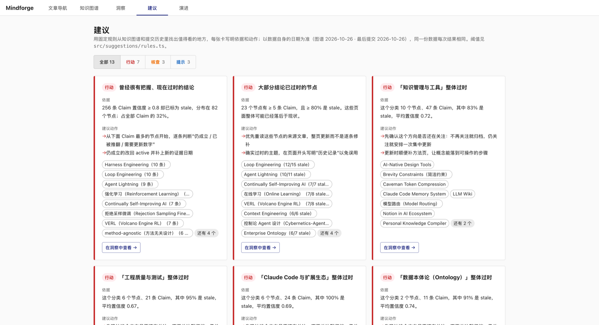
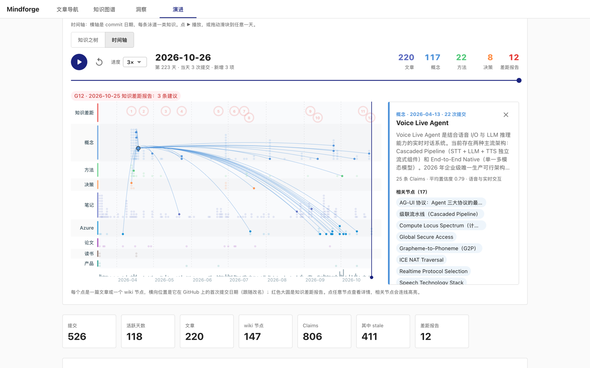
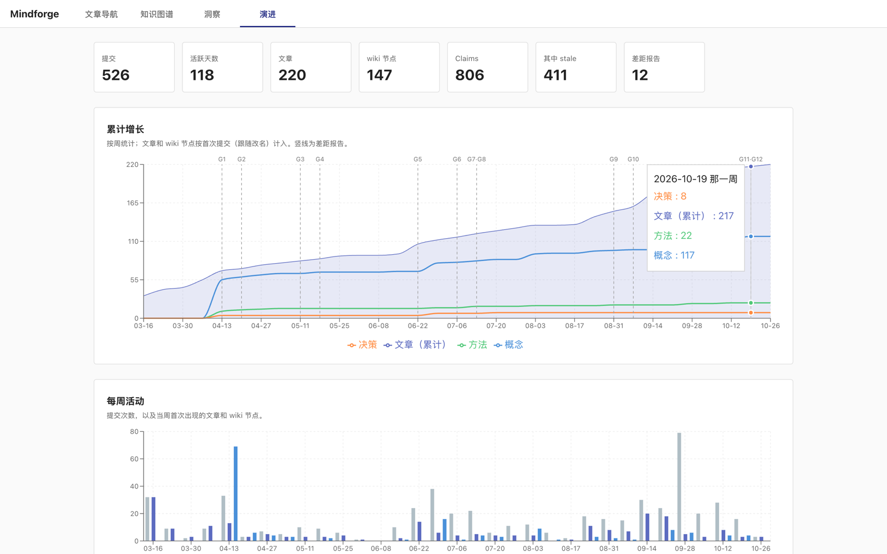
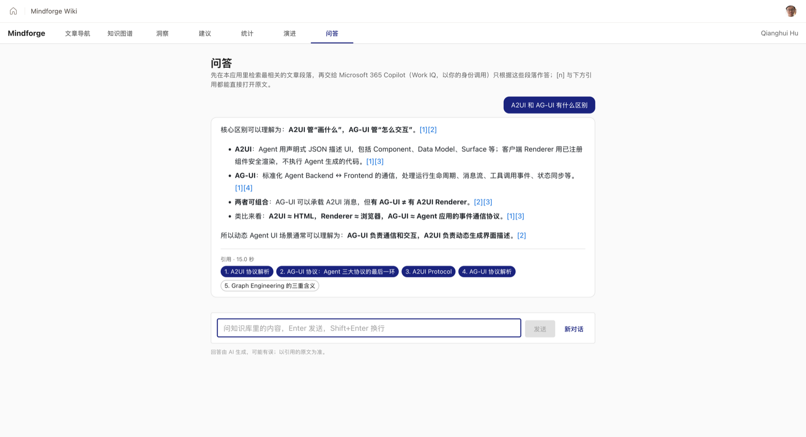
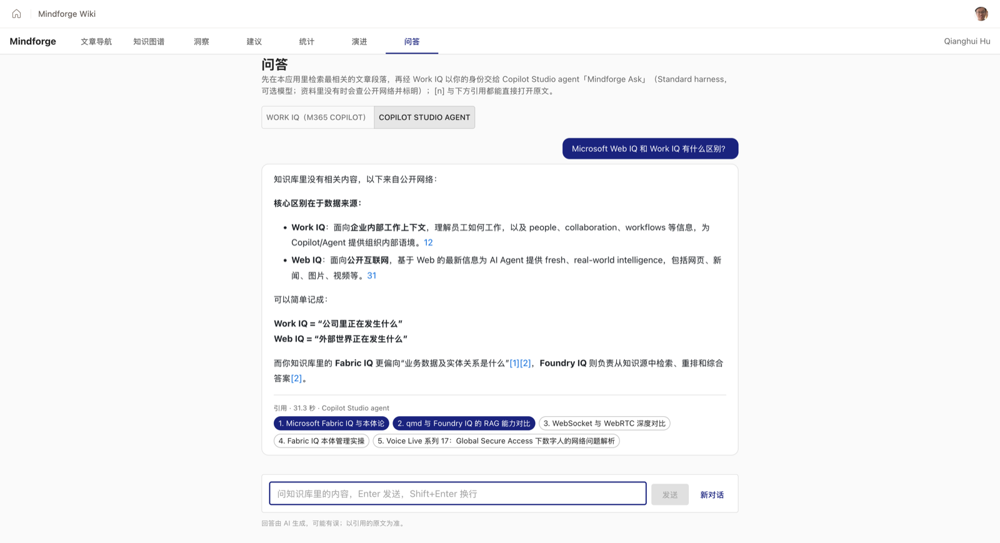

# Mindforge Managed App

把 [Mindforge](https://github.com/huqianghui/mindforge) 知识库部署为 **Microsoft Copilot Managed Runtime** 上的企业内应用，并以它为练习场，逐步学习 Copilot Studio 与 Managed Runtime 的开发：统计、文档分析、Ask Copilot 等 GitHub Pages 静态站点做不到的能力。

> Managed Runtime 目前是 Preview，CLI 与平台行为可能变化。背景与选型见 [Copilot Managed Runtime 系列 01](https://github.com/huqianghui/mindforge/blob/main/Azure/Copilot-Managed-Runtime/Copilot-Managed-Runtime%E7%B3%BB%E5%88%9701%EF%BC%9A%E6%89%98%E7%AE%A1%E7%8E%AF%E5%A2%83%E5%AF%B9%E6%AF%94%E4%B8%8E%E9%80%89%E5%9E%8B.md)，部署过程见 [系列 02](https://github.com/huqianghui/mindforge/blob/main/Azure/Copilot-Managed-Runtime/Copilot-Managed-Runtime%E7%B3%BB%E5%88%9702%EF%BC%9A%E5%AE%9E%E6%88%98%E9%83%A8%E7%BD%B2%E4%B8%8E%E6%9D%83%E9%99%90%E8%A7%A3%E6%9E%90.md)。

**测试地址**：<https://play.preview.managedapps.cloud.microsoft/apps/9ae71e53-dd54-4a36-90ac-0815fd93f03c>（需 Entra 登录，且应用已分享给你）

## 功能一览

顶部七个标签页：**文章导航**、**知识图谱**、**洞察**、**建议**、**统计**、**演进**、**问答**，右侧显示登录用户。截图来自 2026-10-27 的本地版本（`mindforge@8f2aa16`）。

### 文章导航 `#/doc/<path>`

左侧是由同步路径自动生成的目录树：每个大类（笔记、Azure、论文、读书、产品、Wiki）有自己的图标与数量，当前文章所在的目录自动展开高亮；输入关键词时切换为全文标题搜索。右侧渲染 Markdown，站内链接、wikilink、图片都改写成应用内地址。


### 阅读进度与收藏

在 Managed App 里打开时，SDK `getUser()` 识别登录用户。文章右上角的星标用来收藏；滚动位置自动记录，再次打开时显示"上次读到 N% · 继续阅读"。左栏顶部列出**我的收藏**和**最近阅读**（各带进度），左下角显示同步状态。

数据存放在平台托管的 **App state**（`state/schema.json`，集合 `readingState` 声明为 `x-ms-ownership: perUser`）。平台按登录身份隔离数据，前端不传用户 ID，也就无法读写别人的记录。浏览器本地另存一份：用 `npm run dev` 运行，或 App state 请求失败时，仍可在本机使用，并如实标明"仅保存在本机"。

起初按路线图用 Dataverse 表实现，读取能走通，但公司租户的 DLP 屏蔽了 Dataverse connector 的写入动作，于是改用 App state。经过见 [04 新功能开发指南 · 阶段 4](docs/04-新功能开发指南.md#阶段-4个性化sdk-getuser--app-state)。



### 知识图谱 `#/graph`

wiki 的 147 个概念 / 方法 / 决策节点与 516 条关系，可按节点类型、关系类型筛选，点节点看论断（Claim）、关联节点与原文。这是**相关性**维度。



### 洞察 `#/insights`

把 806 条 Claim 展平后多维筛选：类型、状态、置信度、分类、标签、更新月份、关键词，筛选条件写进地址栏便于分享。四张图（分类 × 状态、置信度分布、按月更新、关系类型）**点柱子即筛选**；下方从节点钻取到 Claim，再跳回来源文章（77% 的 Claim 能匹配到原文）。


### 建议 `#/suggestions`

用固定规则从图谱和提交历史里找出值得处理的地方，以数据自身的日期为准，同一份数据每次结果相同（阈值在 `src/suggestions/rules.ts`）。每张卡写明**依据**和**建议动作**，分行动 / 核查 / 提示三级，列出涉及的节点（点开即 wiki 页面），并可一键跳到洞察页的对应筛选。



### 统计 `#/stats`

同步时由 `scripts/stats.py` 预计算，前端只做聚合展示：总字数（中文按字、英文按词，不含代码块与链接地址）、按首次提交周分板块堆叠的字数累计、各板块篇数与篇均字数、最长的 10 篇、主题标签分布（大小写合并，去掉 wiki / concept 这类结构性标签）、**系列完成度**（文件名带"系列 NN"的文章，缺号以虚线标出，30 天内有新篇算进行中）和**链接健康度**（站内 / 外部 / 指向私有日记 / 坏链，坏链列出所在文章与目标）。


### 演进 `#/timeline`：知识之树

**时间**维度。一棵按固定种子生成的树从小苗开始，每翻过一个有内容的日子（右侧台历，共 106 页，含差距报告的日子）就长高、分叉一点，知识越多长得越快；文章和 wiki 节点是叶子，12 期知识差距报告是花。可选 1×–10× 速度。


鼠标移到树上即暂停并进入交互：叶子换成知识类别的颜色，悬停看标题，点击看详情与相关节点。


### 演进 `#/timeline`：时间轴

切换到时间轴视图：横轴是 GitHub commit 日期，每条泳道一类知识，红圈是差距报告；可播放、拖动到任意一天。选中一个节点会把相关性叠加回来——连线到相关节点和贡献它的文章。



下方还有按 commit 时间统计的累计增长（竖线标出 G1–G12 差距报告）、每周活动、Claims 健康度、分类成长，以及每期差距报告的建议（标出沿袭上期的建议）。



### 问答 `#/ask`

先在应用内检索：同步时生成的 `search.json`（每篇的标题、描述、标签、各级标题、开头一段）按"英文词 + 中文二元组"打分，取前 5 篇，再拉正文挑出最相关的段落并编号。然后经 **Work IQ Copilot MCP** connector，以当前用户的身份交给 Microsoft 365 Copilot，要求只根据这些段落作答，用 `[n]` 标注出处，最后一行写 `RELATED: 1, 3`。应用把 `[n]` 和引用标签都渲染成应用内原文链接；用到的来源是实心标签，检索到但没用上的是空心标签。文章页的"就这篇提问"会把当前文章固定为第一条资料。

不需要建 Copilot Studio agent，引用也是结构化的（来源由应用检索决定），一次回答通常 15–20 秒。实现与返回格式的细节见 [04 · 阶段 5](docs/04-新功能开发指南.md#阶段-5ask-copilotwork-iq--本地检索)。



页面顶部可切换到 **Copilot Studio agent** 后端：同样的检索结果和提示词，交给在 Copilot Studio 里建的 Standard harness agent「Mindforge Ask」。它可以在 agent 里选模型，开着 Web Search：资料里没有答案时会去公开网络查，并以"知识库里没有相关内容，以下来自公开网络："开头，网页引用和知识库 `[n]` 引用分开显示。它不是经 Copilot Studio Connector 调用的（那个动作要求回调地址，浏览器里收不到），而是发布到 Microsoft 365 Copilot 后，经 Work IQ 的 `agentId` 调用。过程见 [03 · 实测](docs/03-Copilot-Studio集成指南.md#实测从-managed-app-调用-standard-agent2026-10-28)。



## 和 GitHub Pages 版本的区别

| | GitHub Pages（mindforge 仓库） | 本项目（Managed Runtime） |
|---|---|---|
| 访问 | 公开 | Entra 登录，按人/组分享 |
| 内容 | README 导航 + 文章 + 知识图谱 | 同一份内容，从 mindforge 仓库同步 |
| 能力 | 静态页面 | 可接 Connector（Copilot Studio agent、Azure OpenAI、SharePoint 等），可读取登录用户身份，按用户保存数据（App state） |
| 定位 | 公开知识库 | 学习与实验 Copilot Studio / Managed Runtime 开发 |

## 结构

```text
src/
  App.tsx              顶部导航 + hash 路由（#/doc/<path>、#/graph、#/insights、#/suggestions、#/stats、#/timeline、#/ask?q=&doc=）
  GraphPage.tsx        知识图谱（react-force-graph）
  docs/                README 导航与文章阅读：manifest 加载、Markdown 渲染、链接改写；收藏、继续阅读、我的收藏 / 最近阅读
  platform/            SDK 调用集中在这里：user.ts（getUser，宿主外超时视为匿名）、readingState.ts（App state 读写 + 本机兜底）、copilot.ts（Work IQ 的 JSON-RPC 调用与返回解析，可带 agentId）、agent.ts（Copilot Studio agent 的 agentId）
  ask/                 问答页：retrieve.ts（本地检索与段落摘录）、prompt.ts（提示词与 RELATED 解析）、AskPage.tsx
  components/          图谱的筛选栏、节点面板、图例
  insights/            洞察页：Claim 级多维筛选（写进 hash）、分类×状态/置信度/按月/关系类型图表联动、节点 → Claim → 原文钻取
  suggestions/         建议页：rules.ts 里的固定规则与阈值生成"依据 + 动作"卡片，分行动/核查/提示三级，可跳到洞察页对应筛选
  stats/               统计页：字数累计与分板块、最长文章、标签分布、系列完成度、链接健康度（读 stats.json）
  timeline/            演进页：知识之树（分形树随有内容的日子自动生长、台历翻页、鼠标移入看知识）、时间轴回放（泳道蜂群图）、累计增长、每周活动、Claims 健康度、分类成长、差距报告与建议（Recharts，按需加载）
scripts/
  sync-content.py      从 mindforge 拉取内容到 public/content/
  history.py           由 sync-content 调用：从 git 提交历史生成 history.json
  stats.py             由 sync-content 调用：字数、标签、系列、链接健康度 → stats.json
  search.py            由 sync-content 调用：问答用的每篇摘要索引 → search.json（也可单独运行）
  release.sh           同步 → 本地构建 → 提交 → 推送 GitHub 与平台仓库 → deploy
  setup-dataverse.py   阶段 4 的 Dataverse 对比实验：幂等创建发布者 mf、解决方案 Mindforge 与表 mf_readingstate
  keep-env-active.sh   刷新开发者环境的"最近活动"，防止因不活动被禁用（可装成每周定时任务）
public/
  content/             同步生成：文章、图片（哈希命名）、manifest.json 与 history.json
  wiki-graph.json      同步生成：图谱数据
generated/             ms app add data-source 生成的 Connector 数据源描述与 Service（不要手改）
.ms/schemas/           同上，CLI 缓存的 Connector schema
state/
  schema.json          App state 的集合定义（ms project state add 生成，perUser 需手改）
  generated-typescript/  ms project state generate-code 生成的模型、校验与 Service（不要手改）
ms.config.json         Managed Runtime 应用配置（appId、环境 ID、connectionReferences、state）
```

## 两个远端

| 远端 | 地址 | 用途 |
|---|---|---|
| `github` | 本仓库 | 源码与学习记录 |
| `platform` | Managed Runtime 平台托管仓库 | 平台构建与部署的来源 |

Managed Runtime 不能绑定个人 GitHub 仓库，所以源码推到两处：GitHub 存档，平台仓库负责构建。

`ms.config.json` 随源码入库：平台构建要求它在仓库里（缺失时报 `ms.config.json is required to pack an app`），而它只含应用、环境、连接的标识，不含凭据，访问仍需 Entra 登录和授权。`release.sh` 把同一个 `main` 推到两个远端，平台仓库是 GitHub 的镜像（强制推送），不要直接在平台仓库上开发。

## 内容同步

`scripts/sync-content.py` 把 mindforge 克隆到 `.cache/mindforge`（已 gitignore；完整提交历史、不预取文件内容，即 `--filter=blob:none`），只取 git 跟踪的文件：

- `README.md` 以及 `Notes/` `Azure/` `paper/` `book/` `product/` `wiki/` 下的 Markdown
- 这些文章引用到的图片
- `wiki/wiki-graph.json`

文件改用路径哈希命名（避开中文文件名在打包与 URL 上的问题），`manifest.json` 记录原路径、标题和来源 commit。页面左下角显示当前内容对应的 `mindforge@<commit>`。

同步时还会由 `scripts/history.py` 生成 `history.json`，**所有时间都取 GitHub 上的 commit 时间**：每篇文章 / wiki 节点的首次提交时间（跟随改名）与提交次数、按周的累计增长与活动、按周取样的 `wiki-graph.json` 快照（Claims active / stale、分类规模），以及 `wiki/knowledge-gap/` 各期报告和其中的学习建议（是否沿袭上期、点名的页面后来是否建出）。演进页 `#/timeline` 展示这些数据。首次同步需要克隆完整历史并读取约 20 个图谱快照，约一分多钟。随后 `scripts/stats.py` 生成 `stats.json`（约 100 KB）：每篇的字数、标签、链接统计（坏链按文章阅读器的规则解析相对链接与 wikilink，指向不公开日记的 `[[YYYY-MM-DD…]]` 单独算作私有）和系列编号，统计页 `#/stats` 展示。

## 本地开发与发布

前置：Node.js、`npm install -g @microsoft/managed-apps-cli`、Git Credential Manager（平台仓库的 Entra OAuth 依赖它）。

```bash
npm install
ms auth login

# ms.config.json 已在仓库里；换成自己的应用时用 ms app init 重新生成

python3 scripts/sync-content.py   # 同步内容
npm run dev                       # 本地预览

scripts/release.sh                # 同步并发布到 GitHub 与 Managed App
```

## 开发文档

找不到 Copilot Studio、连接、自定义 Connector、环境等页面时，看 [入口速查](docs/00-入口速查.md)。

基于本项目开发新功能前，先读 [docs/](docs/README.md)：项目现状剖析、Managed Runtime 与 SDK 参考、Copilot Studio 集成指南、新功能开发指南。

## 学习路线

按"先前端、再数据、再 AI"的顺序一步步加功能，每一步对应一个可部署的版本：

| 阶段 | 功能 | 学习点 | 状态 |
|---|---|---|---|
| 0 | README 导航、文章阅读、知识图谱 | `ms app init / build / deploy / share`、平台仓库与凭据 | ✅ |
| 1 | 洞察页：按分类/类型/标签/置信度/状态/时间筛选；分类 → 节点 → Claim → 原文钻取；分布与趋势图表（`#/insights`，Claim 来源 77% 可跳回原文） | 纯前端；Recharts；筛选状态与图表联动 | ✅ |
| 2 | 建议卡片：高置信却过时、大部分过时的节点、整体过时的分类、沿袭未落地的差距建议、低置信度、单一来源、未分类、样本太少的分类、孤立节点、近期更新（`#/suggestions`）；冲突 Claim 需语义判断，留给阶段 5/6 | 基于数据的规则，可解释、可复现 | ✅ |
| 3 | 文档统计：文章与节点的提交时间线、Claims 健康度趋势、分类成长、差距报告与建议（演进页 `#/timeline`）；字数、标签分布、系列完成度、链接健康度（统计页 `#/stats`） | 构建期预计算 vs 运行期计算 | ✅ |
| 4 | 个性化：读取登录用户，记录阅读进度与收藏，左栏我的收藏 / 最近阅读 | SDK `getUser()`；App state（按用户隔离）；Dataverse 表作对比，写入被租户 DLP 屏蔽 | ✅ |
| 5a | Ask Copilot（Work IQ）：本地检索 + Work IQ Copilot MCP 回答，`[n]` 与 RELATED 引用跳回原文；文章页"就这篇提问"（`#/ask`） | `ms app add data-source`；MCP JSON-RPC；提示词约定输出协议；连接与首次授权 | ✅ |
| 5b | Ask Copilot（Copilot Studio agent）：Standard harness agent「Mindforge Ask」作为第二种后端，可选模型、资料外的问题查公开网络并标明；问答页切换对比 | 建 Standard agent、解决方案与 schema name、发布需渠道；Copilot Studio Connector 是回调式不可用，改走 Work IQ `copilot_chat` + `agentId` | ✅ |
| 6 | 对比：同样的问答改用 Azure OpenAI Connector + 前端检索 | 两种 AI 接入方式的取舍 | ⬜ |
