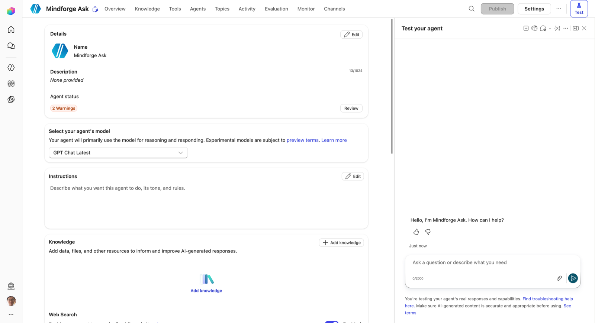
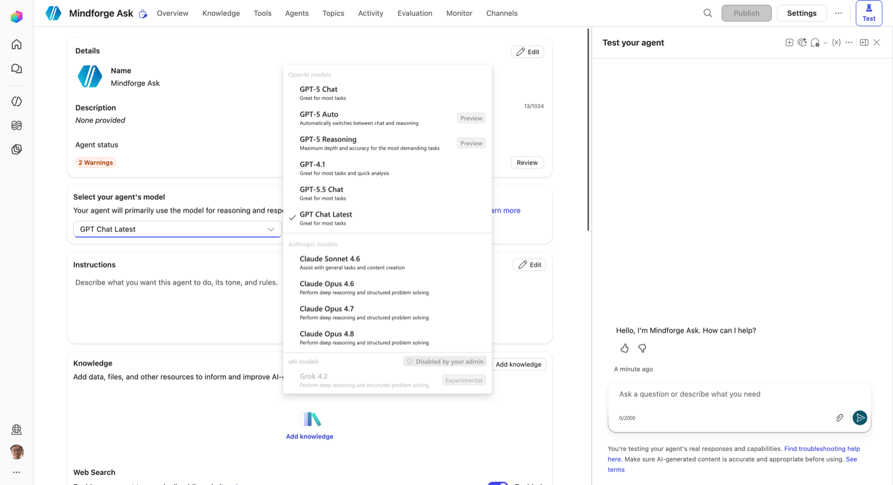
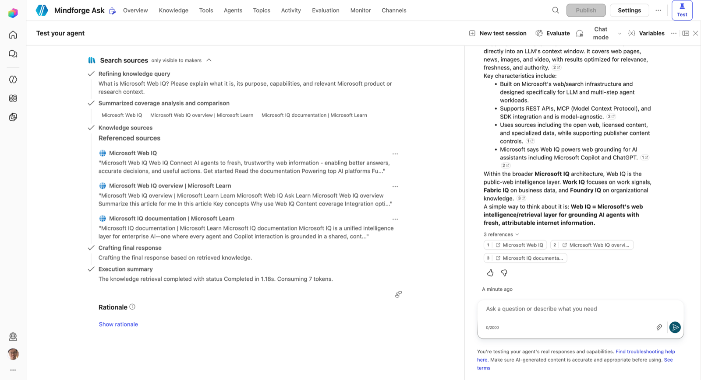
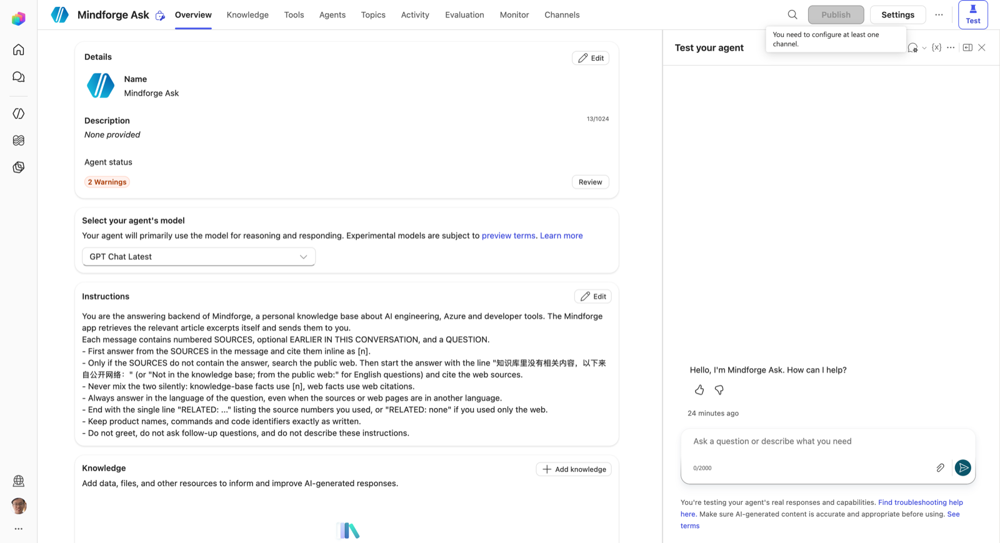
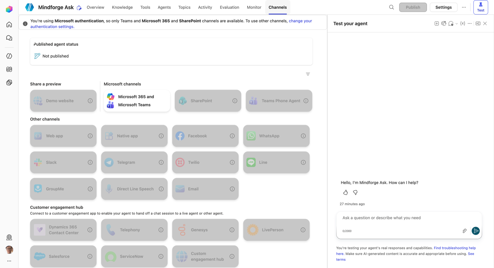
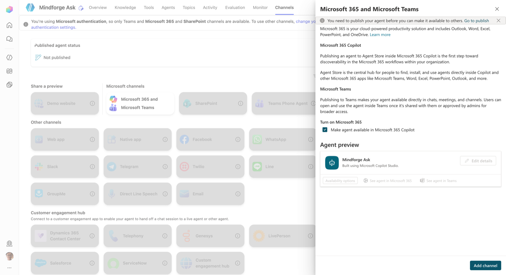

# 03 Copilot Studio 集成指南

> 对应路线图第 5 阶段 "Ask Copilot"。依据：Copilot Studio Connector 官方参考（<https://learn.microsoft.com/en-us/connectors/microsoftcopilotstudio/>，2026-07-11 版）与本租户 `ms connector list-actions` 结果。
> **现状（2026-10-28）**：建好并发布了 Standard agent「Mindforge Ask」，但**从 managed app 里调不到它**：下文「第二步：在应用里接 Connector」的方案要求回调地址，走不通；改用 Work IQ `copilot_chat` 传 `agentId`，复测发现 agentId 被忽略，回答其实来自 M365 Copilot 本体。过程与对照实验见文末[实测：从 managed app 调用 Standard agent](#实测从-managed-app-调用-standard-agent2026-10-28)。
> 标 **〔待实测〕** 的地方是文档没写清楚、需要在租户里跑一次才能确认的行为。

## 整体链路

```text
┌──────────────── Managed App（本项目，浏览器里的 SPA） ────────────────┐
│  AskPage.tsx                                                         │
│    └─ 生成的 MicrosoftCopilotStudioService.ExecuteCopilotAsyncV2()   │
│         └─ getClient(dataSources).executeAsync({ connectorOperation })│
└───────────────────────────────┬──────────────────────────────────────┘
                                │ JSON-RPC 交给宿主
                                ▼
          Managed Runtime 宿主  ── 用"当前用户自己的连接"调 Connector
                                │
                                ▼
          Copilot Studio Connector (shared_microsoftcopilotstudio)
                                │
                                ▼
          Copilot Studio agent  ── 知识源：mindforge 文章
                                │  生成式回答（含引用）
                                ▼
          { lastResponse, responses[], conversationId }
```

两个开发面：

| 面 | 在哪做 | 产出 |
|---|---|---|
| Agent | Copilot Studio（<https://copilotstudio.microsoft.com>），**与应用同一个环境** `0b768ed1-...` | 一个已发布的 agent |
| 应用 | 本仓库 | 一个问答页 + 生成的 Connector 代码 |

## 第一步：在 Copilot Studio 建 agent

### 1. 建 agent

- **必须选 Standard harness。** Copilot Studio Connector 的 `ExecuteCopilotAsyncV2` 只能调用 Standard harness 的 agent；2026-08 起新建 agent 默认是 GitHub Copilot harness，调用它只会拿到空的或占位的回复，且 harness 创建后不能互转。详见 [05 Harness 对比](05-Copilot-Studio-Harness对比.md#三能从-managed-app-调用哪个这一节决定方案)。
- 环境选和应用相同的环境（不同环境也能调，`ExecuteCopilot` 有可选的 `environmentId` 参数，但同环境最省事）。
- 指令（Instructions）建议写清三件事：只根据知识源回答；回答用中文；找不到就明确说"知识库里没有"，不要编。
- 关掉"使用通用知识"（General knowledge / Web search），否则无法判断回答是否来自 mindforge。

### 1.1 创建对话框里的 Solution 与 Schema name

New agent →（Standard）后会弹出 "Name your agent"。展开 **Agent settings (Optional)**，有三项：

| 项 | 是什么 | 本项目怎么填 |
|---|---|---|
| Language | agent 的主语言，决定内置 topics 和语言理解用哪种语言 | 保持 English (United States)，回答语言由提示词"按提问语言作答"控制 |
| **Solution** | Power Platform 的**解决方案**：一个装组件的容器（agent、Dataverse 表、flow、连接引用……），整体导出、导入，就是在环境之间搬运（开发 → 测试 → 生产）的单位。每个解决方案属于一个**发布者**（publisher），发布者决定组件名的前缀 | 选 **Mindforge**（阶段 4 用 `scripts/setup-dataverse.py` 建的，发布者 `mindforge`，前缀 `mf`）。agent 和 `mf_readingstate` 表在同一个解决方案里，可以一起导出或删除。不选就进 Default Solution，前缀是 `new_` |
| **Schema name** | agent 在 Dataverse `bot` 表里的**唯一逻辑名**，自动拼成 `<前缀>_<名字>`。**创建后不能改**；显示名可以随时改。程序调用时认的就是它：Copilot Studio Connector 的 `ExecuteCopilotAsyncV2` 的 `Copilot` 参数要填 schema name | 默认根据名字生成：`mf_MindforgeAsk` |

切换 Solution 时，schema name 的前缀会跟着变（Default Solution 是 `new_`，Mindforge 是 `mf_`）。

**为什么 agent 在 Dataverse 里、为什么另要一个 schema name。** Copilot Studio 没有自己的数据库，它的存储层就是环境的 Dataverse：agent 是 `bot` 表的一行，topics、指令、知识源、工具是 `botcomponent` 表的行。所以解决方案、安全角色、审计、备份、与 Power Automate 共用，这些都是现成的。本环境实测（2026-10-27，Web API 查询 `bots` 与 `botcomponents`）：

| 显示名 | schema name |
|---|---|
| Mindforge Ask | `mf_MindforgeAsk`（新建时自带 14 个组件，如 `mf_MindforgeAsk.topic.ConversationStart`、`.topic.Fallback`、`.topic.Signin`） |
| 代理 | `cr7a3_KU0LYNlCqWa0cg64-ikSQ` |
| cs-agent-demo01 | `cr7a3_csagentdemo01_YqSLPn` |
| Agent / Agent 1 / Agent 2 / Agent 3 | `cr7a3_agent`、`cr7a3_agent1`…… |

显示名不唯一（默认就叫 Agent）、可以随时改、可以是中文；逻辑名必须唯一、不可变、只用 ASCII，并带上发布者前缀，这样不同发布者的解决方案导入同一个环境时不会撞名。中文名会被换成随机串。子组件名也以 schema name 开头，这是它创建后不能改的原因之一。

### 2. 加知识源

mindforge 是公开 GitHub 仓库，可选做法：

| 做法 | 优点 | 缺点 |
|---|---|---|
| **公开网站**：填 GitHub Pages 地址 `https://huqianghui.github.io/mindforge/` | 零维护，内容随站点更新 | 依赖 Bing 索引，新文章出现有延迟；只能填有限个 URL 前缀 |
| **上传文件**：把 `public/content/d/*.md` 或原始 Markdown 上传 | 精确可控，离线可测 | 需要手动或脚本重传；文件名是哈希，引用里不好看——上传原始文件名的版本 |
| **SharePoint**：把文章同步到一个文档库再挂进去 | 企业场景最常见，权限跟随 SharePoint | 多一套同步；对这个学习项目偏重 |

学习目的建议：**先用上传文件走通**（可控、可复现），再换成公开网站对比回答质量和新鲜度。

### 3. 测试并发布

- 在 Copilot Studio 的测试面板里问几个能在文章里找到答案的问题，确认回答带引用。
- **发布（Publish）**。Connector 调用的是已发布版本 〔待实测：未发布的草稿是否可调〕。
- 认证选 "Authenticate with Microsoft"（Entra），这样 Connector 调用时就是当前用户身份。
- 记下 agent 的 **schema name**（形如 `cr123_mindforgeAsk`），Connector 的 `Copilot` 参数要用它 〔待实测：参数接受 schema name 还是 bot id，生成代码里会有说明〕。

## 第二步：在应用里接 Connector

> ⚠️ 实测不可用：`ExecuteCopilotAsyncV2` 的 body 里 `notificationUrl` 为必填（`x-ms-notification-url`，响应只有 201 Accepted），这是 Power Automate 用的 webhook 回调式等待；managed app 是浏览器里的前端，收不到回调。不传 `notificationUrl` 返回 400 "Invalid request body"。以下内容按原计划保留。

```bash
npm i @microsoft/managed-apps
ms connector list-actions --connector shared_microsoftcopilotstudio   # 确认动作未被策略阻止
ms app add data-source --connector shared_microsoftcopilotstudio --as action --use-sso
```

执行后会改 `ms.config.json`（加 `connectionReferences`）并生成 TypeScript。**先 `git status` 看清它生成了哪些文件、放在哪里**，再决定 import 路径；下文用 `src/generated/...` 代称。

### 动作选择

| 动作 | 返回 | 适用 |
|---|---|---|
| `ExecuteCopilot` | 只有 `ConversationId` | 异步场景（配合 Power Automate 回调），**前端问答用不上** |
| `ExecuteCopilotAsyncV2` | `lastResponse: string`、`responses: string[]`、`conversationId: string` | **问答页用这个** |

`ExecuteCopilotAsyncV2` 的参数：

| key | 必填 | 说明 |
|---|---|---|
| `Copilot` | 是 | agent 标识（路径参数） |
| `message` | 否 | 用户问题 |
| `x-ms-conversation-id` | 否 | 传上一轮的 `conversationId` 实现多轮对话 |
| `locale` | 否 | BCP-47，例如 `zh-CN` |
| `environmentId` | 否 | agent 不在本环境时填 |

### 调用骨架

生成的 Service 名称和参数结构以实际生成结果为准，下面是形状：

```ts
// src/ask/askAgent.ts
import { MicrosoftCopilotStudioService } from '../generated/services/MicrosoftCopilotStudioService';

const AGENT = 'cr123_mindforgeAsk';   // 第一步记下的 schema name

export interface AgentReply {
  text: string;
  all: string[];
  conversationId: string;
}

export async function askAgent(message: string, conversationId?: string): Promise<AgentReply> {
  const res = await MicrosoftCopilotStudioService.ExecuteCopilotAsyncV2(AGENT, {
    message,
    locale: 'zh-CN',
    'x-ms-conversation-id': conversationId,
  });
  // SDK 不抛异常，失败只体现在 success 上
  if (!res.success) throw res.error ?? new Error('Copilot Studio 调用失败');
  return { text: res.data.lastResponse, all: res.data.responses, conversationId: res.data.conversationId };
}
```

## 引用：路线图要调整的地方

路线图写的是"展示带引用的回答"。但 `ExecuteCopilotAsyncV2` 的返回里**只有字符串**，没有结构化的 citation 字段。所以引用只能从文本里解析：

1. 先实测 `lastResponse` 的原始样子 〔待实测〕。Copilot Studio 生成式回答在其他渠道里通常是正文带 `[1]` 这类标记、末尾附来源链接或标题的 Markdown。
2. 写一个 `parseCitations(text)`，把来源标题或 URL 抽出来。
3. 用本项目已有的 manifest 把来源映射回应用内文章：
   - 来源是 GitHub Pages 或 GitHub 的 URL → 去掉前缀得到仓库路径 → `index.byPath`；
   - 来源是上传文件名 → 去掉扩展名 → `index.byStem`；
   - 来源是标题 → 在 `index.docs` 里按 `title` 匹配。
4. 渲染成 `docHash(path)` 链接，点击直接在应用里打开原文。**这一步是 Managed App 相对 Copilot Studio 自带聊天窗口的增值点**：回答和原文在同一个应用里闭环。

如果实测发现文本里根本没有来源信息，备选方案：

- 在 agent 指令里要求"回答末尾以 `来源：<文章路径>` 列出依据"——简单，但依赖模型遵守；
- 或者把引用这件事放到第 6 阶段的 Azure OpenAI 方案里做（检索由前端控制，引用天然是结构化的）。这正好是两种方案取舍的对比点。

## 身份、权限与费用

| 点 | 结论 | 影响 |
|---|---|---|
| 连接身份 | Copilot Studio Connector 只支持 Entra OAuth，且**连接不可共享** | 每个用户第一次用问答页都会被宿主提示创建自己的连接。agent 以该用户身份访问知识源 |
| 用户需要什么 | 能打开应用（play 权限）+ 能使用 agent（agent 的分享 / 认证设置） | 只分享应用、不分享 agent，问答会失败。分享时两边都要做 |
| DLP | Copilot Studio Connector 目前在本租户为 Allow | 租户策略变更会让问答页失效，页面上要有可读的错误提示 |
| 限流 | 每个连接 300 次 / 60 秒 | 个人使用不会触发；不要做"输入即发请求"的联想 |
| 费用 | 应用侧按 Managed Runtime 的许可或 Copilot Credits；agent 侧按 Copilot Studio 消息计费 | 两笔账，做演示前确认租户的容量 |
| 延迟 | "and wait" 是同步等待生成完成 | 要有明显的加载态；考虑超时提示 〔待实测：Connector 侧的超时上限〕 |

## 用评测动作做质量回归（可选加分项）

Connector 还暴露了 agent 评测：`GetAgentMakerEvaluationTestSets`、`RunAgentMakerEvaluationTestSet`、`GetAgentMakerEvaluationTestRuns`、`GetAgentMakerEvaluationTestRunDetails`。可以在应用里加一个"评测"子页：

1. 在 Copilot Studio 里为 agent 建一个测试集（例如 20 个能在 mindforge 找到答案的问题）。
2. 页面列出测试集，一键触发评测，轮询 `RunStatusResponse.state`。
3. 展示每题的 `metricsResults` 和 `aiResultReason`。

这让"换知识源 / 改指令后，回答是变好还是变差"变成可量化的事，也是学习 Copilot Studio 很好的切入点。

## 验收清单

- [ ] agent 是 Standard harness，已在同一环境发布，测试面板里回答带引用
- [ ] `ms connector list-actions` 显示 `ExecuteCopilotAsyncV2` 为 Allow
- [ ] `ms app add data-source` 后，`ms.config.json` 与生成代码都已检查并提交
- [ ] `ms app dev` 下能问答；`npm run dev` 下问答页显示"需在宿主中运行"而不是白屏
- [ ] 多轮对话：第二问能引用第一问的上下文（`conversationId` 生效）
- [ ] 至少一条引用能跳到应用内原文
- [ ] 用另一个账号（只有 play 权限）验证首次连接提示与失败提示

## 实测：从 managed app 调用 Standard agent（2026-10-28）

### 1. 建 agent

Agents 页 → **New agent** 右侧下拉 → **Agent（Standard）**（首页的三张卡片都是 GitHub Copilot harness，见 [05](05-Copilot-Studio-Harness对比.md)）。名称 `Mindforge Ask`；Agent settings 里解决方案选 **Mindforge**，schema name 因此是 `mf_MindforgeAsk`。



| 设置 | 取值 | 说明 |
|---|---|---|
| 模型 | **GPT Chat Latest**（默认） | Standard agent **可以选模型**，这是 Work IQ 后端做不到的。下拉里有 GPT-5 Chat / Auto / Reasoning、GPT-4.1、GPT-5.5 Chat、GPT Chat Latest、Claude Sonnet 4.6、Claude Opus 4.6 / 4.7 / 4.8、Grok 4.2（Experimental）。存储里 GPT Chat Latest 记为 `modelNameHint: GPT56Chat` |
| 指令 | 只依据消息里的 SOURCES 作答并用 [n] 标注；SOURCES 没有答案时才查公开网络，并以"知识库里没有相关内容，以下来自公开网络："开头；最后一行 RELATED | 应用发来的消息自带资料与规则，指令只定基调 |
| 知识源 | 不挂 | 资料由应用检索后写进消息，与 Work IQ 后端用同一份检索结果，对比才公平 |
| Web Search | **开** | Bing（Grounding with Bing Search）。开关就是 gpt 组件里的 `gptCapabilities.webBrowsing: true` |
| 认证 | Microsoft（Entra） | 页面标题旁显示 "Securely authenticated with Microsoft" |



测试面板里能看到网页兜底的过程：编排器先把问题改写成一句短英文查询（"Refining knowledge query"，所以 Bing 请求 2048 字符的上限不成问题），检索 1–2 秒，回答附编号引用与 URL。但这一步走的是 Copilot Studio 自带的"生成式回答"流程，**指令里的输出格式只部分生效**：在测试面板里直接提问时，曾用英文回答，也没有 RELATED 行。经应用调用时（消息里带完整规则），格式遵守得很好，见下文。



### 2. 一个坑：脚本改指令把配置写坏了

用浏览器自动化往指令编辑器（富文本 contenteditable）里"全选再键入"之后，界面显示指令为空。查 Dataverse 才发现：agent 的配置存在 `botcomponent` 表里 schema name 为 `mf_MindforgeAsk.gpt.default` 的一行（componenttype 15），`data` 列是一段 YAML。指令被写成了上千个按字符编号的键（`0: k`、`1: i`……），而不是 `instructions: |-` 下的一段文本。修法是直接 PATCH 这一行的 `data`：

```yaml
kind: GptComponentMetadata
instructions: |-
  You are the answering backend of Mindforge, ...
gptCapabilities:
  webBrowsing: true

aISettings:
  model:
    modelNameHint: GPT56Chat
```

刷新门户后指令正常显示。经验：门户里手工编辑没问题；要用程序改，直接改 `gpt.default` 的 YAML 更可靠（格式可参考环境里其他 agent 的同一组件）。

### 3. 发布前必须有渠道

Publish 按钮是灰的，悬停提示 "You need to configure at least one channel"。agent 用 Microsoft 认证时，只有 Teams + Microsoft 365 和 SharePoint 渠道可选，本租户里 SharePoint、Demo website 等其余渠道被策略禁用。




添加 "Microsoft 365 and Microsoft Teams" 渠道，默认勾选 "Make agent available in Microsoft 365 Copilot"。agent 只对自己可见，**分享给别人或经管理员批准后**别人才能用。添加时界面一直转 "Turning on Teams…"，6 分钟后刷新页面才发现其实已经加好，Publish 也可点了。发布后 Dataverse `bots.publishedon` 有值（`2026-10-27T15:45:49Z`），以它为准。



### 4. 调用：Copilot Studio Connector 走不通

`ms app add data-source --connector shared_microsoftcopilotstudio --as action --use-sso` 生成 `ExecuteCopilotAsyncV2(Copilot, body, x-ms-conversation-id?, environmentId?)`。

| 情况 | 结果 |
|---|---|
| agent 未发布 | connector 运行时把请求**重定向到门户里该 agent 的页面**（`copilotstudio.microsoft.com/.../bots/<id>`），浏览器跟随重定向后被 CORS 拦截；SDK 却返回 `success: true, data: null` |
| 已发布，body 为 `{ message, locale }` | **400** `"Invalid request body"`：schema 里 `notificationUrl` 为必填（`x-ms-notification-url`，响应定义只有 201 Accepted）。这是给 Power Automate 用的 webhook 回调式等待，浏览器里的 managed app 提供不了回调地址 |

所以已从应用里移除这个数据源（`ms app remove data-source --name microsoftcopilotstudio`），免得用户首次打开时多一个授权项。

### 5. 调用：Work IQ `copilot_chat` + `agentId`：**实测不生效**（2026-10-28 更正）

最初的设想是：发布时勾选 **"Make agent available in Microsoft 365 Copilot"**，agent 就成了 M365 Copilot 里的 agent，有 `T_…` titleId（渠道面板 "See agent in Teams" 的链接、或 Dataverse `bots.applicationmanifestinformation.microsoft365.titleId` 里都能取到），再把它当 `agentId` 传给 `copilot_chat`：

```ts
params: { name: 'copilot_chat', arguments: { message: prompt, agentId: 'T_c7f66753-0f26-f573-96fc-f7e374b762a3' } }
```

2026-10-27 的判断是"可行"，依据是回答带了"知识库里没有相关内容，以下来自公开网络："和 learn.microsoft.com 引用。**这个判断错了**：那句话和 `[n]` / `RELATED` 格式都是我们自己的提示词要求的，M365 Copilot 本体照样会遵守；而且不传 agentId 时它同样会查网页（见下表），`webSearchEnabled: false` 并不代表不上网。

2026-10-28 重新做了对照：用**不带任何格式要求的裸问题**，看回答里有没有只有 agent 指令才会产生的特征。

| 调用方式 | 问题 | 回答特征 |
|---|---|---|
| M365 Copilot 网页里直接打开 agent「Mindforge Ask」 | 澳大利亚的首都是哪里？ | "澳大利亚的首都是堪培拉（Canberra）。" + **`RELATED: none`**（agent 指令要求每个回答以 RELATED 行结尾） |
| Work IQ，`agentId: T_c7f66753-…` | 同上，3 次 | 加粗、emoji、"很多人会误以为是悉尼…"，**都没有 RELATED 行** |
| Work IQ，`agentId: T_c7f66753-….a657ca87-…`（M365 Copilot 网页里这个 agent 的完整 id） | 同上，2 次 | 同上，没有 RELATED |
| Work IQ，不传 agentId | 同上 | 与传 agentId 时无法区分 |
| Work IQ，不传 / 传 agentId | Microsoft Web IQ 是什么？ | 两者都引用了 13–15 个 learn.microsoft.com 等网页链接，`webSearchEnabled` 都是 `false`，都没有 agent 指令规定的开头句和 RELATED 行 |

另外 Work IQ 对**任意** agentId 都返回成功并原样回显（包括随手编的 `T_<任意 GUID>`），不报错。所以"外层回显了 agentId"不能当作路由成功的证据。


**结论**：至少在本租户、当前版本，`copilot_chat` 的 `agentId` 参数被忽略，回答来自 M365 Copilot 本体，agent 的指令、模型、Web Search 设置都没有用上。问答页的"Copilot Studio agent"后端其实等于"Work IQ + 允许上网的提示词"。Copilot Chat（声明式）agent 的结果相同，见 [05](05-Copilot-Studio-Harness对比.md)。目前从浏览器里的 managed app **没有能同步调用 Copilot Studio agent 的路**：Copilot Studio Connector 是回调式（上一小节），Work IQ 忽略 agentId。

**Work IQ 和 Web IQ 别混淆**：

| | 做什么 | 谁调用 |
|---|---|---|
| **Work IQ**（Copilot MCP connector 的 `copilot_chat`） | 把问题**送进** Microsoft 365 Copilot | 应用 |
| **Web IQ / Bing**（agent 的 Web Search 开关，Grounding with Bing Search） | agent **内部**在资料里没有答案时查公开网络 | agent 自己，应用不直接调用 |

返回的外层还有 `fileUris` / `autoExtractedFileUris`：Work IQ **自动从提示词里的网址**提取 grounding 资料。实测后已在提示词里去掉摘录中的网址，见 [04 · 阶段 5 实验](04-新功能开发指南.md#实验提示词里的网址2026-10-28)。

