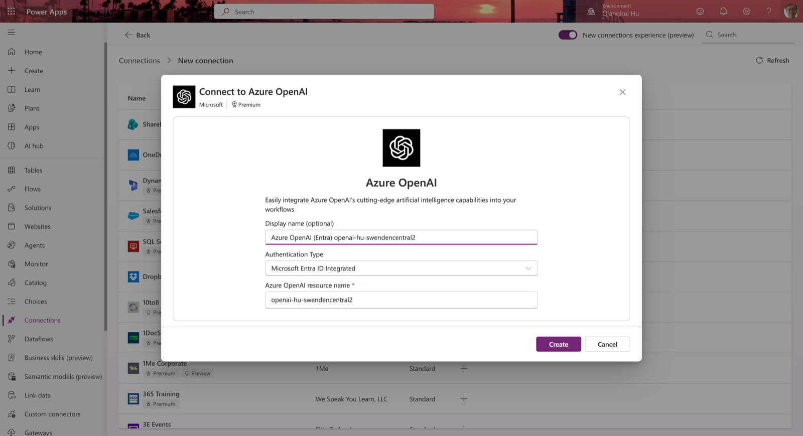
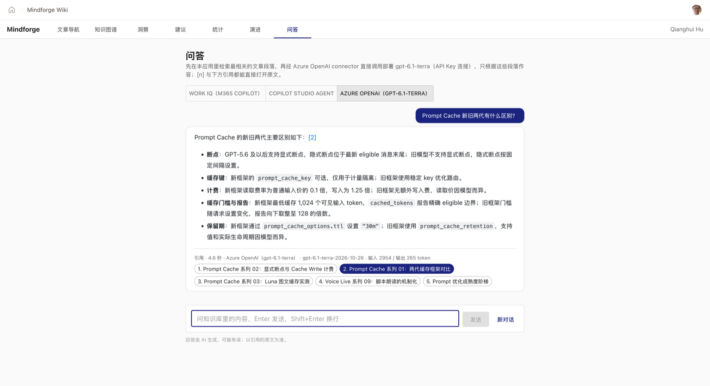

# 04 新功能开发指南

> 前置阅读：[01 项目现状剖析](01-项目现状剖析.md)、[02 Managed Runtime 与 SDK 参考](02-Managed-Runtime与SDK参考.md)。
> 本文给出：加功能的通用套路、沿用的代码约定、路线图 1–6 阶段每一步的具体设计。

## 一、通用套路

### 1. 加一个页面

三处改动，全部在 `src/App.tsx`：

```ts
// ① Route 联合类型加一项
type Route =
  | { view: 'graph' }
  | { view: 'insights' }                       // 新增
  | { view: 'doc'; path: string; anchor?: string };

// ② parseHash 加一条，放在 doc 匹配之前
if (hash.startsWith('#/insights')) return { view: 'insights' };

// ③ Tabs 加一项，渲染处加分支
<Tab value="insights" label="洞察" component="a" href="#/insights" />
```

页面放在 `src/<feature>/<Feature>Page.tsx`，和 `src/docs/` 一样按功能分目录。重页面（图表库、Connector 调用）用 `React.lazy` 引入，顺带缓解现在主 chunk 超过 500 kB 的问题：

```ts
const InsightsPage = lazy(() => import('./insights/InsightsPage'));
```

### 2. 页面带筛选状态时，状态进 hash

用户会分享链接、会刷新。把筛选条件放进 hash 的查询串（`#/insights?cat=ai-agent&status=stale`），沿用 `#/doc/<path>?a=<anchor>` 的风格，解析写在 `parseHash` 里，生成写一个和 `docHash()` 对应的小函数。

### 3. 数据加载沿用现有两种模式

| 模式 | 现有例子 | 何时用 |
|---|---|---|
| 模块级缓存的 Promise + hook | `src/docs/content.ts` 的 `loadIndex()` / `useContentIndex()` | 全应用共享、只加载一次的数据 |
| 组件内 `useEffect` fetch | `src/hooks/useGraphData.ts` | 只有一个页面用 |

图谱数据现在只被 `GraphPage` 用；洞察页也要用它，**先把 `useGraphData` 里的加载抽成 `content.ts` 那样的共享缓存**，避免两个页面各拉一次 `wiki-graph.json`。

### 4. 调 SDK 时让 `npm run dev` 仍可用

SDK 只在宿主里工作（02）。把所有 SDK 调用收进 `src/platform/` 一处，对外暴露"可能不可用"的接口：

```ts
// src/platform/user.ts
import type { IUser } from '@microsoft/managed-apps/auth';

// 不在宿主里（纯 vite dev）时 getUser 拿不到结果；限时等待，超时视为匿名
export async function currentUser(timeoutMs = 3000): Promise<IUser | null> {
  try {
    const { getUser } = await import('@microsoft/managed-apps/auth');
    return await Promise.race([
      getUser(),
      new Promise<null>((resolve) => setTimeout(() => resolve(null), timeoutMs)),
    ]);
  } catch {
    return null;
  }
}
```

页面拿到 `null` 时显示"该功能需在 Managed App 中运行（`ms app dev` 或线上）"，而不是报错或白屏。〔待实测：SDK 在非宿主环境下是挂起还是立即报错，决定超时是否必要〕

### 5. 构建期预计算优先

Managed Runtime 没有后端（01、02）。能在 `scripts/sync-content.py` 里算好的，就写进 `manifest.json` 或新的 JSON，前端只做展示和筛选。经验规则：

| 计算 | 放哪 |
|---|---|
| 依赖全部 Markdown 正文（字数、链接、标签） | 构建期 |
| 只依赖图谱 JSON 的聚合（分布、计数） | 运行期，数据量小（147 节点 / 806 Claim） |
| 依赖当前用户（进度、收藏） | 运行期 + Connector |
| 依赖 LLM | 运行期 + Connector |

### 6. 每一阶段一个可部署版本

每完成一阶段：`npm run build && npm run lint` 通过 → `ms app dev` 自测 → `scripts/release.sh "<描述>"` → 在 README 路线图把状态改成 ✅。

## 二、代码约定（照现有代码写）

- TypeScript strict，函数组件 + hooks，`export default function XxxPage()`。
- UI 用 MUI，按组件单独 import（`import Box from '@mui/material/Box'`），样式写 `sx`。
- 颜色和中文标签集中在 `src/theme.ts`，新增枚举（例如 Claim 状态）也加在那里。
- 界面文字与代码注释用中文；注释只写"为什么"，密度保持现在的水平（每个文件几条）。
- 搜索用已有的 Fuse.js，不再引入第二个搜索库。
- 新依赖只在确实需要时加，加之前看一眼对 bundle 的影响。

## 三、路线图逐阶段设计

### 阶段 1：洞察页（纯前端）

**目标**：按分类、类型、标签、置信度、状态、时间筛选；分类 → 节点 → Claim → 原文逐层钻取；分布与趋势图。

**新增**：

```text
src/insights/
  InsightsPage.tsx      页面骨架：左筛选、右图表 + 列表
  useInsights.ts        把 WikiGraph 展平成 Claim 行，按筛选条件过滤与聚合
  ClaimTable.tsx        Claim 列表，点击行 → 节点面板 / 原文
  charts.tsx            分布与趋势图
```

**数据**：直接用 `wiki-graph.json`，展平成一行一个 Claim：

```ts
interface ClaimRow extends WikiClaim {
  nodeId: string;
  nodeTitle: string;
  nodeType: WikiNode['type'];
  category: string;       // 空串归入"未分类"（有 30 个节点）
  tags: string[];
}
```

**图表**：路线图写的是 Recharts，`npm i recharts`。建议的四张：

| 图 | 维度 | 能看出什么 |
|---|---|---|
| 分类 × 状态 堆叠柱 | category × active/stale | 哪个领域知识过时最多 |
| 置信度直方 | confidence 0.3–0.9 | 整体把握程度（目前集中在 0.7–0.8） |
| 按月趋势 | `last_updated` 月份 | 知识更新节奏（2026-04 到 2026-10） |
| 关系类型分布 | `relation_type` | 知识图谱的"语法"偏好 |

点击图上的柱子 = 设置对应筛选，列表与其他图联动。这就是路线图里"筛选状态与图表联动"的学习点。

**钻取到原文**：节点 → wiki 页用 `index.byStem.get(node.id)`（同 `NodePanel.tsx:78`）；Claim → 来源文章需要用 `claim.source`（文章标题）去 manifest 里匹配，匹配逻辑写成 `content.ts` 里的一个函数，阶段 5 的引用解析也会复用它。

### 阶段 2：建议卡片（规则引擎）

**目标**：用可解释、可复现的规则给出"该去看什么"。

**新增**：`src/insights/suggestions.ts`（纯函数）+ `SuggestionCards.tsx`。

```ts
interface Suggestion {
  id: string;              // 规则 id，便于测试和去重
  title: string;
  reason: string;          // 一句话解释为什么出现，必须能复现
  targets: { nodeId: string; claimIndex?: number }[];
  severity: 'high' | 'medium' | 'low';
}

export function buildSuggestions(graph: WikiGraph, now: Date): Suggestion[]
```

**初始规则**（阈值写成常量，放在文件顶部）：

| 规则 | 条件 | 现有数据下的规模 |
|---|---|---|
| 低置信度 | `confidence < 0.6` | 16 条 Claim |
| 过时 | `status === 'stale'` | 411 条，需要再按节点聚合，只展示 stale 占比最高的节点 |
| 薄弱分类 | 分类成员数 ≤ 2 | AI 硬件、FinOps、Ontology 三个分类 |
| 未分类 | `category === ''` | 30 个节点 |
| 孤立节点 | 度为 0 | 目前 0 个，规则保留 |
| 近期更新 | `last_updated` 在 14 天内 | 用于"最近学了什么" |
| 冲突 | 同一节点上相互矛盾的 Claim | 需要语义判断，**留到阶段 5/6 交给 LLM** |

`buildSuggestions` 是纯函数，适合补第一批单元测试（项目目前没有测试框架，可以加 `vitest`）。

### 阶段 3：文档统计（构建期预计算）

**目标**：文章数量与字数趋势、标签分布、系列完成度、链接健康度。

**改 `scripts/sync-content.py`**：在 `doc_entries` 里多写几个字段（保持旧字段不变，前端兼容）：

```python
{
  "path": ..., "title": ..., "file": ...,
  "chars": 12345,              # 去掉 front matter 和代码块后的字符数
  "tags": ["azure", "copilot"],
  "date": "2026-10-26",        # front matter 的 date，或 git log 首次提交日期
  "links": {"internal": 12, "broken": ["Azure/不存在.md"]},
  "series": "Copilot-Managed-Runtime"   # 从"系列NN"文件名规则提取
}
```

- `date` 用 git 历史：已改为 `--filter=blob:none` 的完整历史克隆，首次提交时间由 `scripts/history.py` 计算（跟随改名），写在 `history.json` 的 `docs` 字段，可直接复用。
- 链接健康度复用 `DocView.tsx` 的解析规则（相对路径、wikilink），Python 里重写一份，规则不一致时以前端为准。
- 同时更新 `src/docs/content.ts` 的 `DocEntry` 类型，新字段都标可选。

**前端**：`src/stats/StatsPage.tsx`，图表沿用阶段 1 的 Recharts。

这一阶段的学习点是"构建期 vs 运行期"：所有数字在 deploy 那一刻固定，页面上要标明 `generatedAt` 和 `sourceCommit`（`DocsPage.tsx` 左下角已有同样的展示，照抄）。

### 阶段 4：个性化（SDK `getUser()` + App state）

**目标**：识别登录用户，记录阅读进度与收藏。**已完成**，最终用 App state 实现；Dataverse 方案做到一半，被租户 DLP 挡住，过程保留在下面作对比。

**落地结构**：

```text
src/platform/user.ts          currentUser()：动态 import getUser，限时 3 秒，超时或报错视为匿名（null）
src/platform/readingState.ts  模块级 store + useSyncExternalStore；读写 App state，本机 localStorage 兜底
state/schema.json             集合 readingState：docPath（索引）、scroll、lastReadAt、favorite
state/generated-typescript/   ms project state generate-code 生成，不要手改
```

- `DocView`：右上角星标收藏；滚动停止 600 ms 后记录进度（顶部 2% 以内不算，也不覆盖已有进度）；再次打开显示"上次读到 N% · 继续阅读"。`DocsPage` 以 `key={path}` 渲染它，换文章即重新挂载，不必在 effect 里重置状态。
- `DocsPage` 左栏：我的收藏、最近阅读（前 5 篇，带进度），左下角显示同步状态。
- 写入去抖 1.5 秒；每篇文章记住 `itemId`，首次 `create`（POST），之后 `update`（PUT，**整条覆盖**，所以每次都写全部字段）。

#### 做法：App state

```bash
ms feature enable --name state                 # 实验特性，ms.config.json 会多出 state.enabled
ms project state add --collection readingState
ms project state add --collection readingState --property docPath --type string --required true \
  --index true --index-ignore-case false --max-length 400
ms project state add --collection readingState --property scroll --type number --min-value 0 --max-value 1
ms project state add --collection readingState --property lastReadAt --type datetime
ms project state add --collection readingState --property favorite --type boolean
# 关键：按用户隔离没有命令行参数，要手改 schema
#   "$defs": { "readingState": { "type": "object", "x-ms-ownership": "perUser", ... } }
ms project state generate-code
```

实测要点：

| 观察 | 说明 |
|---|---|
| 不加 `x-ms-ownership: perUser`，生成的 `DataClient` 第二个参数是 `false` | 集合是**所有用户共享**的，任何人都能读到别人的收藏。这是最容易踩的坑 |
| 加上之后请求带 `?scope=private`，返回的每条都有 `@ms.scope` | 平台按登录身份隔离，前端不传、也伪造不了用户 ID。这比 Dataverse 方案里"按 objectId 过滤"安全得多 |
| 接口是同源的 `/.ms/state/<集合>/items` | 符合 CSP `connect-src 'self'`，不经过 Connector，所以**不受 Connector DLP 影响**，也不需要用户授权连接 |
| `ms app dev` 和 `npm run dev` 都不提供 `/.ms/state` | 只能部署后验证。本项目的做法：先建临时提交，只推到平台仓库并 deploy，验证通过后再 amend，推 GitHub |
| 第一次带 state 的 deploy 返回过一次 504 | 直接重试成功 |
| 线上验证 | `GET …/items?scope=private` 200 → 收藏后 `POST` **201** → 刷新后同一篇变成 `PUT …/items/<itemId>` 200，说明是从云端读回的，不只是本机缓存 |
| 生成的 `client.ts` 触发 ESLint `no-control-regex` | 在 `eslint.config.js` 的 `globalIgnores` 里排除 `state/generated-typescript` |

#### 对比实验：Dataverse（被 DLP 挡住）

1. `scripts/setup-dataverse.py` 用 Dataverse Web API 幂等创建发布者 `mindforge`（前缀 `mf`）、解决方案 `Mindforge`、**用户拥有**的表 `mf_readingstate`（主列存文章路径，加 `mf_userobjectid`、`mf_scrollratio`、`mf_lastreadat`、`mf_favorite`）。进度和收藏的主键都是（用户, 文章），所以合成一张表。脚本用 `az account get-access-token --resource <org-url>` 取令牌，用 curl 发请求（python.org 版 Python 默认没有根证书，urllib 会报 `CERTIFICATE_VERIFY_FAILED`）。
2. `ms app add data-source --connector commondataserviceforapps --as action --dataverse-environment-id <env> --table mf_readingstate --use-sso --non-interactive`：自动建了 SSO 连接，但提示 **"Skipped 22 of 45 actions due to your organization's connector policy"**。`CreateRecordWithOrganization`、`UpdateRecordWithOrganization` 等写入动作被租户 DLP 屏蔽，生成的 `Mf_readingstatesService` 只有 `ListRecords / GetItem / DeleteRecord`。
3. 在宿主里实测（`ms app dev --local-app-url http://localhost:5179 --config-only`）：`getUser()` 正常，`ListRecords` 读取 200；直接调 `getClient(dataSources).createRecordAsync('mf_readingstate', …)` 返回 **404**。SDK 对这种调用走表格型路径 `datasets/…/tables/…/items`，Dataverse connector 不提供这个路径；Dataverse 表的写入只能走上面那些被屏蔽的动作。
4. 手工把被屏蔽的动作补进生成的 `dataSources.ts` 就等于绕过组织策略，不做。随后 `ms app remove data-source` 移除了这两个数据源，免得用户打开应用时还要授权一个用不到的连接。表和脚本保留，作为对比。

| | Dataverse 表 | App state |
|---|---|---|
| 建 schema | Web API / maker portal，要有发布者与解决方案 | `ms project state add`，schema 跟源码一起入库 |
| 经过 Connector | 是：要建连接，受 DLP 管控 | 否：同源 `/.ms/state` |
| 按用户隔离 | 靠表的拥有者 + 安全角色；前端按 objectId 过滤只是筛选 | `x-ms-ownership: perUser`，平台强制 |
| 本地调试 | `ms app dev` 可用 | 不可用，只能部署后验证 |
| 成熟度 | 正式功能，可被 Power Apps / Power Automate / agent 共用 | 实验特性，数据只属于这个应用 |
| 本租户结果 | 读可以、写被 DLP 屏蔽 | 读写都通 |

选择依据：数据只给这个应用自己用，不需要和 agent、流程共享，App state 更简单也更安全。如果以后要让 Copilot Studio agent 读取用户的收藏（例如"根据我收藏的文章回答"），就得回到 Dataverse，并请管理员放开写入动作。

### 阶段 5：Ask Copilot（Work IQ + 本地检索）

**状态**：5a Work IQ 后端、5b Copilot Studio agent 后端均已完成，问答页可切换。5b 的建 agent、发布与调用路径（Copilot Studio Connector 不可用，改走 Work IQ + agentId）见 [03 · 实测](03-Copilot-Studio集成指南.md#实测从-managed-app-调用-standard-agent2026-10-28)（要先在门户里建 Standard harness 的 agent，见 [03](03-Copilot-Studio集成指南.md)）。先做 Work IQ，是因为它不需要建 agent，引用也由应用自己控制，做法与参考应用一致（[10 · 2.6](10-参考应用拆解与功能模式.md)）。

```text
scripts/search.py            同步时生成 public/content/search.json（386 篇约 530 KB，只在问答页加载）
src/ask/retrieve.ts          检索：问题切成英文词 + 中文二元组（去掉"什么""如何"这类虚词），
                             按 idf × 字段权重（标题 4、标签 3、描述 2、标题行 2、开头 1）给文章打分取前 5；
                             再拉正文按标题切段，每篇挑最相关的 2 段，最多 1600 字
src/ask/prompt.ts            提示词：只用 SOURCES 作答、按提问语言、[n] 标注、最后一行 RELATED: n；带最近 2 轮问答
src/platform/copilot.ts      Work IQ 调用与返回解析
src/ask/AskPage.tsx          #/ask?q=<预填问题>&doc=<固定为第一条资料的文章>
```

#### 5b：Copilot Studio agent 后端的链路

```text
问答页（选 Copilot Studio agent）
  │ ① 应用内检索 search.json → 取 5 篇文章的相关段落，拼成提示词（带 SOURCES 和规则）
  ▼
Work IQ Copilot MCP connector（shared_a365copilotchatmcp，以当前用户身份）
  │ ② JSON-RPC tools/call: copilot_chat
  │    arguments: { message: 提示词, agentId: "T_c7f66753-…" }
  ▼
Graph Copilot Chat API → Microsoft 365 Copilot
  │ ③ 看到 agentId，把这一轮交给 M365 Copilot 里的 agent「Mindforge Ask」
  ▼
Mindforge Ask（Copilot Studio Standard harness，模型 GPT Chat Latest）
  │ ④ 按它的指令：先用 SOURCES 回答；没有答案才用 Web Search（Bing）上网，并标明来源
  ▼
返回：外层 JSON（回显 agentId）→ rawResponse 里最后一条消息就是回答
  │ ⑤ 应用解析 [n] / RELATED，渲染成原文链接；网页引用显示为外链
```

5a 与 5b 用同一个 Work IQ connector 和 `copilot_chat` 工具，区别只在是否传 `agentId`。注意 **Work IQ**（把问题送进 M365 Copilot）和 **Web IQ / Bing**（agent 内部的 Web Search）不是一回事。建 agent、发布、为什么不能用 Copilot Studio Connector，见 [03 · 实测](03-Copilot-Studio集成指南.md#实测从-managed-app-调用-standard-agent2026-10-28)。

#### 接入

```bash
ms connector list-actions --connector shared_a365copilotchatmcp   # Work IQ Copilot (Preview)  Allowed  mcp_m365copilot
ms app add data-source --connector shared_a365copilotchatmcp --as action --use-sso --non-interactive
# 生成 generated/services/WorkIQCopilotMCPService.ts，返回类型是 void，实际内容要自己解析
```

请求体是 MCP 的 JSON-RPC，直接 `tools/call`，不需要先 `initialize`：

```ts
WorkIQCopilotMCPService.mcp_m365copilot(undefined, {
  jsonrpc: '2.0', id, method: 'tools/call',
  params: { name: 'copilot_chat', arguments: { message: prompt } },
});
```

#### 返回格式（实测，比文档复杂）

`result.content[0].text` 不是回答本身，而是**两层 JSON 再加一行尾巴**：

```text
{"conversationId":"…","timeZone":"America/Los_Angeles","reply":"",
 "rawResponse":"{\u0022@odata.context\u0022:\u0022…copilotConversation\u0022, … \u0022messages\u0022:[…]}",
 "webSearchEnabled":false,"message":"Copilot chat completed successfully."} CorrelationId: …, TimeStamp: …
```

- `reply` 实测为空，不能直接用。
- `rawResponse` 是**字符串化**的 Graph `copilotConversation`。服务端序列化器把引号、中文、`+`、`` ` `` 都转义成 `\uXXXX`，所以第一版界面原样显示时，看起来像乱码。其实这是合法的 JSON 转义，`JSON.parse` 一次就会还原。
- `messages[0]` 是我们发的提示词，**最后一条**才是回答。
- 解析步骤：去掉 `CorrelationId` 行 → 解析外层 JSON → 解析 `rawResponse` → 取最后一条 text 不等于提示词的消息。任何一步失败都退回原文（`copilot.ts` 里的 `answerOf`）。
- 每次调用都会新开一个 Copilot 会话（`conversationId` 不同），多轮对话靠提示词里的 EARLIER IN THIS CONVERSATION。

#### 实测要点

| 观察 | 说明 |
|---|---|
| 首次调用时宿主弹出 "Allow Mindforge Wiki to access your data?"，列出 Work IQ Copilot MCP | 每个用户第一次用都要同意；同意后平台为这个应用建了一条新连接，挂起的那次调用随后正常返回（那一次连同授权共 74 秒） |
| 之后每次 15–20 秒 | 超过 10 秒，界面会显示"仍在处理" |
| 模型遵守了输出协议 | 回答按 `[1][2]` 标注出处，最后一行 `RELATED: 1, 2, 3`；检索到但没用上的来源不会出现在 RELATED 里 |
| `ms app dev` 可用 | Connector 调用在本地宿主里能跑（App state 不行）；`npm run dev` 下问答页只做检索，并提示需要在宿主中运行 |
| 改 `src/platform/*.ts` 后 Vite 会整页刷新 iframe | 宿主里的问答状态会丢失，测试时要重新提问 |
| 部署 `0d6f712` 时，平台构建跑了约 20 分钟 | `ms app deploy` 轮询 `commitBuildOperations` 时两次网络超时并退出（exit 1），但平台上的构建一直在继续。用 `ms app build-status --commit <sha>` 看到 Succeeded 后，再执行一次 `ms app deploy --commit <sha>`，提示 "A cached build exists … deploying it"，几秒就上线了。所以 CLI 超时不等于构建失败，先查 build-status |

#### 入口与计时

- 洞察页每条 Claim、建议页每张卡片都有"问 Copilot →"，跳到 `#/ask?q=<预填问题>`（`src/ask/askLink.ts`）。只预填、不自动发送，用户可以先选后端或改问题。Claim 的入口还带 `doc=<来源文章>`，把来源固定为第一条资料。
- 回答下方分开显示**检索**耗时（本地，通常几十毫秒）和**回答**耗时（connector + 后端模型），方便看慢在哪一段。

### 阶段 6：Azure OpenAI Connector（直接调模型）

**状态**：已完成。问答页第三个后端 "Azure OpenAI"，与 5a / 5b 用同一份检索结果和提示词（不允许上网）；选中它时出现**部署下拉框**，默认 gpt-6.1-terra，选择记在本机。

```text
问答页（选 Azure OpenAI）
  │ ① 应用内检索 → 提示词（同 5a）
  ▼
Azure OpenAI connector（shared_azureopenai，连接 openAI-hu-SwendenCentral-terra，API Key）
  │ ② ChatCompletions_Create_2024Feb15Preview(requestBody, deployment-id, api-version)
  │    requestBody = { messages: [{ role: 'user', content: 提示词 }] }，deployment-id = gpt-6.1-terra，api-version = 2024-10-21
  ▼
Azure OpenAI 资源 azure-open-ai-hu-sweden-centeral（MngEnv 租户订阅 11b83efa…，demo-rg，swedencentral）
  ▼
choices[0].message.content + usage（页面上显示模型版本与输入 / 输出 token）
```

#### 连接与认证

| 认证方式（connector 支持） | 需要 | 结果 |
|---|---|---|
| Microsoft Entra ID Integrated | 只要资源名；每个用户需有该资源的 Cognitive Services OpenAI User 角色；连接不共享 | **在本环境创建不了**：登录弹窗报 `AADSTS50011`，connector 的第一方应用 `fb0b0d8e-05af-43a7-b23c-843ea5010245` 没有登记回调地址 `https://global.consent.azure-apim.net/redirect/azureopenai`。这是请求进入登录前的应用配置校验，与浏览器、缓存、账号无关（Chrome 与 Firefox 结果相同） |
| **API Key**（采用） | 资源名 + key | 连接可共享：应用分享给别人后，别人也用这把 key 和配额。key 只存在 Power Platform 连接里，不进代码和仓库 |
| Managed Identity | — | 只适用于 Logic Apps |



另外两点：

- 即使 Entra 能建连接，也要注意跨租户：connector 的登录走 `/common`，令牌由账号主租户签发；资源若在另一个租户（比如最初给的 `openai-hu-swendencentral2` 在 Microsoft Non-Production 租户 `16b3c013…`），通常会被拒。本机用 `az account get-access-token --subscription <该租户订阅> --resource https://cognitiveservices.azure.com` 直接调可以通，那是因为令牌直接从资源所在租户取的。
- **部署（模型）不在连接里选**，是每次调用的参数 `deployment-id`。三层各管一件事：

  | 内容 | 在哪定 |
  |---|---|
  | 用哪个资源、什么凭据 | Power Platform 连接（资源名 + key） |
  | 用哪个部署 | 前端：`src/platform/aoai.ts` 的 `AOAI_DEPLOYMENTS` 列表 + 问答页下拉框 |
  | 部署背后的模型版本 | Azure 门户里该部署的配置 |

  connector 没有"列出部署"的动作，所以列表在代码里维护（`az cognitiveservices account deployment list` 查出来后手工补）。只放对话部署，realtime / image / embedding 部署不适用。8 个对话部署用同一条连接、同样的参数逐个实测都能调通（提示"只回答两个字：你好"，`ms app dev`）：

  | 部署 | 返回的模型版本 | 耗时 |
  |---|---|---|
  | gpt-6.1-sol | 2026-09-29 | 6.0 秒（第一个，含冷启动） |
  | gpt-6.1-terra | 2026-10-26 | 2.6 秒 |
  | gpt-6-sol | 2026-09-22 | 2.9 秒 |
  | gpt-6-luna | 2026-09-22 | 2.0 秒 |
  | gpt-6-astra | 2026-09-03 | 2.2 秒 |
  | gpt-5.6-sol | 2026-07-09 | 1.5 秒 |
  | gpt-5.6-luna | 2026-07-09 | 3.1 秒 |
  | gpt-5.6-terra | 2026-07-09 | 2.0 秒 |

  同一问题"Prompt Cache 新旧两代有什么区别？"：gpt-6.1-terra 4.6 秒（输入 2954 / 输出 265 token），gpt-5.6-sol 3.7 秒（输入 2954 / 输出 251 token）。

  

#### 踩到的坑：资源名填成了完整网址

第一次调用一直返回 **502 BadGateway**（内层 500 Internal server error），换 api-version 也一样。用 Power Apps API 查连接的非机密参数（`GET …/apis/shared_azureopenai/connections/<id>`，`properties.connectionParametersSet.values`）才发现资源名填成了 `https://azure-open-ai-hu-sweden-centeral.openai.azure.com/`。connector 会自己拼 `https://<资源名>.openai.azure.com/…`，填网址就拼坏了。改成只填 `azure-open-ai-hu-sweden-centeral` 后正常。连接状态一直显示 Connected，并不校验这个参数。

#### 部署：共享连接必须声明 allowedActions

第一次 `ms app deploy` 被拒：`connectionReferences.<id>.allowedActions: Shared connection references without dataset tables must declare connector-level allowedActions.` API Key 连接是可共享的（`ms.config.json` 里对应条目带 `sharedConnectionId`），平台要求应用声明能经这条连接调哪些动作。只放行用到的那一个：

```json
"authenticationType": "keyBasedAuth",
"sharedConnectionId": "/providers/Microsoft.PowerApps/apis/shared_azureopenai/connections/6bd1d8ab…",
"dataSets": {},
"allowedActions": ["ChatCompletions_Create_2024Feb15Preview"]
```

这样即使应用分享出去，别人借这条共享连接也只能调 Chat Completions，调不了 embeddings 等其他动作。`ms app dev` 不做这项检查，所以本地能跑、部署才报错。

上线后第一次提问时，宿主弹出授权框，列出 Azure OpenAI（共享连接 openAI-hu-SwendenCentral-terra）和 Work IQ 两条连接；点 Allow 前那次提问的计时包含了等待授权的时间（显示 230 秒）。授权后线上实测 8.4 秒（输入 5087 / 输出 179 token）。

#### 实测对比（同一问题"Prompt Cache 新旧两代有什么区别？"）

| 后端 | 耗时 | 模型 | 说明 |
|---|---|---|---|
| Azure OpenAI（gpt-6.1-terra） | **4.6 秒** | 自己选的部署 | 直接调模型；返回 usage（输入 2954 / 输出 265 token） |
| Work IQ（M365 Copilot） | 15–26 秒 | M365 Copilot 自动路由 | 多了 Copilot 编排、企业搜索 grounding、自动抓取提示词里的网址 |
| Copilot Studio agent（经 Work IQ + agentId） | 25–36 秒 | agent 里选 | 再多一层 agent 编排；资料外的问题会查网页 |

三者引用都遵守 `[n]` + RELATED 协议。取舍：Azure OpenAI 最快、最可控、按 token 计费，但需要自己的 Azure 资源与 key 管理；Work IQ / agent 走用户自己的 M365 身份与许可，无需 Azure 资源，能用上企业 grounding 与网页搜索，代价是慢和不可控。


## 四、开始之前的建议顺序

1. 清理遗留：`package.json` 的 `name` 改成 `mindforge-managed-app`，删掉 `refresh` 脚本，修掉 `DocView.tsx:64` 的 lint 错误。
2. 抽出图谱数据的共享加载（阶段 1 的前置）。
3. 页面拆包（`React.lazy`），给后面的图表库和 SDK 留出体积。
4. 然后按阶段 1 → 6 推进。阶段 4 和 5 都需要在租户里新建连接，属于对外可见的操作，执行前确认身份和环境。
