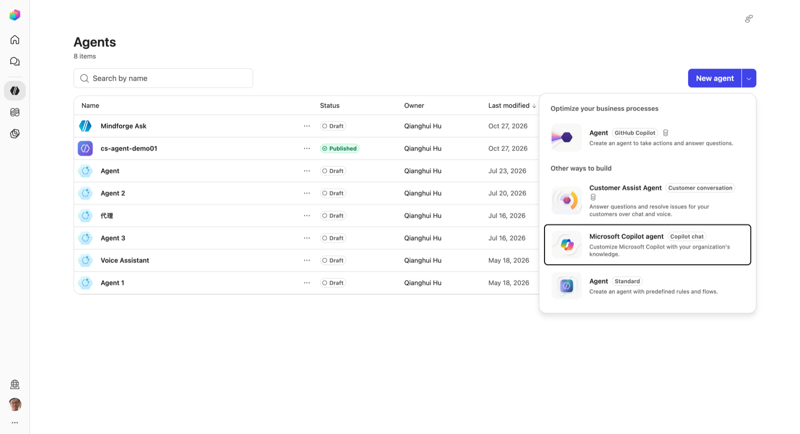
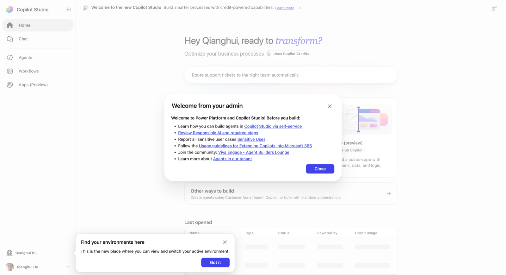

# 05 Copilot Studio Harness 对比

> 学习系列第 1 篇。资料截至 2026-10-27，来源见文末。标 **〔待实测〕** 的是文档没写清、需要在租户里验证的点。

## 一句话

**harness 是夹在"你配置的 agent"和"模型"之间的运行时**：它决定什么时候调模型、把哪些上下文塞给模型、怎么解释返回、调哪个工具。模型负责推理，harness 负责组织推理。Copilot Studio 里建的一切（agent、workflow、app）都跑在某个 harness 上，而 harness 决定了三件事：**能力、计费、能从哪里调用它**。

第三点对本项目最关键，放在第三节单独讲。

## 一、四种 harness

> 更正：本文最初按三种写。2026-10 官方文档（Agents overview、Customer Conversation harness overview）已列出**四种**，第四种是面向客户语音 / 聊天的 **Customer Conversation harness**。

### 门户里的"新建"菜单与 harness 的对应

Agents 页 **New agent** 右侧的下拉菜单（截图 2026-10-27，环境 Qianghui Hu）：

| 菜单项（标签） | 对应 harness | 造出来的 agent 叫什么 | 计费（菜单上的硬币图标 / 列表 Credit usage 列） | 能否从 managed app 调（2026-10-28 实测） |
|---|---|---|---|---|
| **Agent**（GitHub Copilot）——"Optimize your business processes"下唯一一项，也是 New agent 按钮的默认动作 | GitHub Copilot harness | Agent | 有硬币图标：Copilot Credits，构建、测试、运行都算 | ❌ |
| **Customer Assist Agent**（Customer conversation） | **Customer Conversation harness**（预览） | Customer Assist Agent | 有硬币图标：Copilot Credits | 文档未提，〔待实测〕；它面向网站聊天和电话号码渠道 |
| **Microsoft Copilot agent**（Copilot chat），点击后在新标签页打开 | Copilot Chat harness | 运行在 Microsoft 365 Copilot Chat 里的 agent | 包含在 M365 Copilot 许可内 | ❌（只在 Copilot Chat 里用；经 Work IQ `agentId` 也实测无效） |
| **Agent**（Standard）——"Other ways to build"下最后一项 | Standard harness | 经典 agent | 列表里写着 "Included with your Microsoft 365 Copilot license at no additional credit cost"，Credit usage 显示 N/A | 经 Copilot Studio Connector ❌（`ExecuteCopilotAsyncV2` 是回调式）；发布到 M365 Copilot 后经 Work IQ `copilot_chat` + `agentId` ❌（agentId 被忽略，回答来自 M365 Copilot 本体；2026-10-28 复测更正） |

**Copilot Chat agent 的 ❌ 只指"不能经 Copilot Studio Connector 调用"。** 它是挂在 Microsoft 365 Copilot Chat 里的声明式 agent，由 M365 Copilot 的编排器执行，不在 Copilot Studio 运行时里，所以 `ExecuteCopilotAsyncV2` 调不到它。程序进入 M365 Copilot 只有 Graph Copilot Chat API 这一个入口，而阶段 5a 用的 Work IQ `copilot_chat` 包装的正是这个 API。它有一个可选参数 `agentId`（"Agent ID for the Microsoft Copilot conversation"），按道理可以经同一条链路把问题交给指定的 Copilot Chat agent：应用 → Work IQ connector → `copilot_chat`（带 agentId）→ Graph Chat API → 该 agent。2026-10-28 实测：**agentId 不生效**。Standard agent「Mindforge Ask」和新建的 Copilot Chat agent「Mindforge Ask Lite」（titleId `T_cbd8f8f5-…`）都试了，短 titleId 和 M365 Copilot 网页里的完整 id（`T_….<id>` / `T_….<id>.gpt.default`）都试了：调用都成功、agentId 原样回显，但回答与不传 agentId 时无法区分，agent 指令规定的输出特征（如 `RELATED` 行）只在 M365 Copilot 网页里直接用 agent 时出现。对照表见 [03 · 实测 §5](03-Copilot-Studio集成指南.md#实测从-managed-app-调用-standard-agent2026-10-28)。对本项目价值不大：这类 agent 的长处是挂 SharePoint 等企业知识，而 mindforge 内容在 GitHub、资料由应用检索后写进提示词；模型也仍由 M365 Copilot 决定。

**有没有专门给语音用的？** 没有单独的语音 harness。最接近的是 **Customer Assist Agent**：它的描述是 "Answer questions and resolve issues for your customers over chat and voice"，同一个 agent 既能挂到网站上聊天，也能分配电话号码接听来电，指令里可以分别写 Speech 和 Chat 两种模态的要求。架构上是一个主 agent 加若干专门的子 agent，每个子 agent 都有自己的升级路径，答不了时转人工，像联络中心的不同队列。它的定位是**面向外部客户的服务**，不是给个人做语音助手的。列表里那个叫 "Voice Assistant" 的旧 agent 是 Standard harness，名字只是名字。

已有 agent 用的是哪种 harness，看 Agents 列表的 **Powered by** 列（GitHub Copilot / Standard / ……），把鼠标悬停在上面，会显示计费说明。

| | Standard | GitHub Copilot | Copilot Chat | Customer Conversation |
|---|---|---|---|---|
| 定位 | 规则驱动的 agent、结构化对话、可重复流程 | 推理密集、长时间运行、多步骤业务流程 | 给 Microsoft 365 Copilot Chat 接企业知识 | 面向客户的语音与聊天服务，答不了转人工 |
| 工作方式 | 按你写的 topics、触发条件、分支走 | 给一个目标，自己拆步骤、选工具、失败重试 | 把知识源挂到 Copilot Chat 里 | 主 agent 按指令把问题分给子 agent，可调工具、知识、MCP，支持 skills 和 memory |
| 发布对象 | 内部或外部 | 内部或外部 | 仅内部 | 外部客户：网站、电话号码 |
| 计费 | 有 M365 Copilot 许可的内部用户不另计 Credits（列表实测提示） | Copilot Credits | 包含在 M365 Copilot 许可内 | Copilot Credits |

下面这张表保留最初三种 harness 的细节对比：

| | Standard | GitHub Copilot | Copilot Chat |
|---|---|---|---|
| 定位 | 规则驱动的 agent、结构化对话、可重复流程 | 推理密集、长时间运行、多步骤业务流程 | 给 Microsoft 365 Copilot Chat 接企业知识 |
| 工作方式 | 按你写的 **topics、触发条件、分支**走 | 给一个目标，**自己拆步骤**、选工具、失败重试 | 把知识源挂到 Copilot Chat 里 |
| 编排 | 可配置（经典 / 生成式编排） | 固定为增强编排，不可配置 | Copilot Chat 自身 |
| 文件处理 | 不是重点 | 原生读写 Word / Excel / PowerPoint / PDF；带 Bash 沙箱 | 不是重点 |
| Skills / Memory | 不是重点 | 支持 | 不是重点 |
| 发布对象 | 内部或外部客户 | 内部或外部客户 | 仅内部 |
| 计费 | 原有 Copilot Studio 许可模式；有 M365 Copilot 许可的内部用户可豁免 | **全程按 Copilot Credits**，构建、测试、运行都计费，M365 Copilot 许可**不豁免** | 包含在 M365 Copilot 许可内，或按量 |
| 典型场景 | HR 工单收集与分派、内部帮助台 | 应付账款对账、合规审计、客户会议准备（多源、多产出） | 员工入职问答（SharePoint 知识） |

补充：

- **创建时选定，不能互转。** GitHub Copilot harness 的 agent 不能改成 Standard，反之亦然；要换只能重建。
- **新建 agent 的默认选项是 GitHub Copilot harness**（2026-08-03 起）。首页的 Agent / Workflow / App 三张卡片都标着 GitHub Copilot；要建 Standard，可以在首页点 **Other ways to build**，或在 Agents 页点 New agent 右侧的下拉箭头，选 **Agent（Standard）**（见上图）。

- **GitHub Copilot harness 不是 GitHub Copilot 服务。** 只是共享底层技术和 SDK，数据不会发给 GitHub Copilot 服务，原有的 Copilot Studio 合规承诺不变。

## 二、Standard 和 GitHub Copilot 怎么选

官方的判断原则：**按任务的"重量"选**。

| 维度 | 选 Standard | 选 GitHub Copilot |
|---|---|---|
| 任务长度 | 短、步骤少、一个主要产出 | 长时间、多步骤、多个产出 |
| 路径 | 能提前写清楚 | 写不清，需要边做边判断 |
| 上下文 | 有边界的数据和文档；上下文分散在 topics、变量、子 agent 里，由你管交接 | 大文件、大数据集，共享上下文，跨运行的记忆 |
| 可预测性 | 要求高 | 可以接受执行路径不完全可预测 |
| 延迟与费用 | 高并发、面向用户、要求响应快 | 能为推理质量多付延迟和 Credits |
| 能力成熟度 | 渠道和功能成熟 | 最新模型与 agentic 能力，部分渠道仍在完善 |

官方特别提醒两个反面：

1. **简单任务用 GitHub Copilot harness 会"想太多"**：多余的推理、更长的延迟、更多的 Credits，结果却不更好。
2. **能用的 Standard agent 不必迁移。** 迁移等于重新架构，要先定义任务、边界、评估标准，再把 topics / flows / 变量映射到 instructions、skills、tools、workflows、memory。

官方还给了一个组合用法，值得记住：**GitHub Copilot harness 的 agent 定时在后台做重活（整理数据、建表、打标签），Standard agent 在前台高并发地回答用户。** 每个 harness 用在它最划算的地方。

## 三、能从 managed app 调用哪个？——这一节决定方案

这是对本项目影响最大的事实：

| harness | Copilot Studio Connector（`ExecuteCopilotAsyncV2`） | 其他调用方式 |
|---|---|---|
| Standard | ⚠️ 浏览器里的 managed app **用不了**：动作要求回调地址 `notificationUrl`（为 Power Automate 设计），不传返回 400 "Invalid request body"；草稿 agent 则被重定向到门户页面、被 CORS 拦下（2026-10-28 实测） | 发布到 M365 Copilot 后经 Work IQ `copilot_chat` 的 `agentId`：❌ 实测被忽略；Direct Line、Copilot Studio client SDK（受 CSP 与渠道策略限制） |
| GitHub Copilot | ❌ **不支持**。官方已在 PowerAppsCodeApps 仓库确认为已知限制，暂无时间表；Power Automate 文档也写明连接器不能调用这类 agent | 只能在 Copilot Studio **workflow** 的 agent 节点里调；社区有自建自定义连接器调用"agentic runtime"的做法，非官方支持 |
| Copilot Chat | 不适用（它扩展的是 M365 Copilot Chat） | Work IQ `copilot_chat` 的 `agentId`：❌ 实测被忽略（2026-10-28） |

### GitHub Copilot harness 的 agent 发布到哪里

官方 "Available channels for agents (GitHub Copilot)"（2026-10-16 更新）列出的渠道：

| 渠道 | 状态 | 说明 |
|---|---|---|
| Microsoft Copilot | ✅ | 出现在 M365 Copilot 的 agent 列表里——**这是它的主战场** |
| Microsoft Teams | ✅ | 在 Teams 里聊天 |
| Demo website | ✅ | 测试和演示用的现成网页 |
| Web app | ✅ | 用 iframe 嵌入自己的网页 |
| MCP client | Preview | 把 agent 暴露成远程 MCP server，只在 early release 环境 |
| A2A client | Preview | 用 A2A 协议给其他 agent 调用，只在 early release 环境 |
| Copilot Studio workflow 的 agent 节点 | ✅ | 后台自动化里调用 |
| SharePoint、Native app（Direct Line）、WhatsApp、Slack、Teams 以外的消息渠道、联络中心、Email 等 | ❌ 暂不可用 | Standard harness 大多支持 |

可以看出设计意图：**GitHub Copilot harness 的 agent 定位是"用户在 Copilot / Teams 里直接对话的助手"和"后台 workflow 的执行者"**，不是"给别的应用当 API 调的后端"。被程序调用的口子（MCP、A2A）还在 Preview。

对 managed app 而言，理论上还剩两条路，都不理想：

| 路径 | 问题 |
|---|---|
| Web app 渠道的 iframe 嵌入 | **被 CSP 禁止**：managed app 的响应头是 `frame-src 'self'`，不能嵌入任何外部 iframe（2026-10-27 实测，见 [06](06-托管位置与连接链路.md#22-应用被允许做什么csp实测)）。另外，嵌入代码只在 "No authentication" 时提供；回答在 iframe 里，应用也拿不到文本 |
| MCP / A2A 渠道 | Preview 且仅 early release 环境；managed app 本身是浏览器里的 SPA，没有 MCP / A2A 客户端，仍需一个 Connector 或后端中转 |

结论：

- **managed app 里做 Ask Copilot，如果走 Copilot Studio agent，就必须建 Standard harness 的 agent。** 而新建默认是 GitHub Copilot harness，一不留神就会建错，调用时只拿到空的或占位的回复。
- **而且即使是 Standard，也不能经 Copilot Studio Connector 调**（回调式，见上表）。曾以为可以发布到 Microsoft 365 Copilot 后经 Work IQ `copilot_chat` 传 `agentId`，复测证明 agentId 被忽略。目前浏览器里的 managed app 没有同步调用 Copilot Studio agent 的路。
- 已经写好的 [03 Copilot Studio 集成指南](03-Copilot-Studio集成指南.md) 已按这一点修正。

## 四、对本项目的意义

我们的 Ask Copilot 场景是：**基于 mindforge 文章回答问题，带引用**。对照上表：

| 判断点 | 我们的情况 | 倾向 |
|---|---|---|
| 任务重量 | 一问一答，有边界的知识源 | Standard |
| 可预测性 | 希望"只根据文章答，答不出就说没有" | Standard |
| 调用路径 | 要从 managed app 里调 | 实测**哪种都调不到**（Connector 回调式，Work IQ 忽略 agentId） |
| 费用 | 个人学习，希望可控 | Standard（或 Copilot Chat） |
| 文件生成、长任务 | 不需要 | — |

**所以第 5 阶段建的是 Standard harness**，但 2026-10-28 复测发现从 managed app 调不到它，应用里的问答实际只用 Work IQ 和 Azure OpenAI。 GitHub Copilot harness 留给以后真有"重活"时再试，比如：定时扫描 mindforge 的 stale Claim、生成一份周报 Word 文档。那时它通过 workflow 跑在后台，和 managed app 解耦。

还有第四条路不经过 Copilot Studio agent：**直接调 Microsoft 365 Copilot / Work IQ**。截图里那个参考应用的 Ask Copilot 底部写着 "Microsoft 365 Copilot, under your own sign-in"，看起来就是这条路。它和 harness 的取舍，放到下一篇讲 Connector 时一起对比。

## 五、计费速记

| 项 | 规则 |
|---|---|
| Standard harness agent | 原有 Copilot Studio 许可；有 M365 Copilot 许可的内部用户使用经典 harness 时豁免 Credits〔待实测：以本租户的计费设置为准〕 |
| GitHub Copilot harness agent | 构建、测试、评测、运行**都**消耗 Copilot Credits，许可不豁免 |
| Copilot Chat harness | 包含在 M365 Copilot 许可，或按量 |
| Managed app 运行 | 每次 API 调用（启动、经 Connector 读写、发布）0.1 Credits；有 Power Apps Premium 的用户不消耗 Credits（计入每日请求额度） |
| Work IQ API | 单独按量计费，Premium 也不覆盖 |
| Copilot Studio 里生成 app | 按用量计费，在 PPAC 按环境管理 |

费用规则在 Preview 期变化很快，动手前到 Microsoft 365 admin center → Copilot → Cost management 看本租户的实际策略。

## 参考资料

- Harnesses in Copilot Studio：<https://learn.microsoft.com/en-us/microsoft-copilot-studio/harnesses-overview>
- Compare Copilot Studio agent harnesses：<https://learn.microsoft.com/en-us/microsoft-copilot-studio/guidance/choose-harness>（2026-09-30 更新）
- Agents powered by the GitHub Copilot Harness overview：<https://learn.microsoft.com/en-us/microsoft-copilot-studio/agents-experience/overview>
- Available channels for agents (GitHub Copilot)：<https://learn.microsoft.com/en-us/microsoft-copilot-studio/agents-experience/publication-channels-overview>（2026-10-16 更新）
- Call Copilot Studio agents from Power Automate（harness 与连接器支持表）：<https://learn.microsoft.com/en-us/power-automate/call-copilot-studio-agent>
- ExecuteCopilotAsyncV2 不支持 GitHub Copilot harness 的讨论与官方答复：<https://github.com/microsoft/PowerAppsCodeApps/discussions/434>
- Code Apps 连接 Copilot Studio：<https://learn.microsoft.com/en-us/power-apps/developer/code-apps/how-to/connect-to-copilot-studio>
- Copilot Managed Runtime licensing FAQ：<https://learn.microsoft.com/en-us/microsoft-365/admin/manage/apps/licensing-faq>
- What's new in Copilot Studio, August 2026：<https://www.microsoft.com/en-us/copilot/blog/copilot-studio/new-and-improved-github-copilot-harness-agent-skills-and-richer-context>
